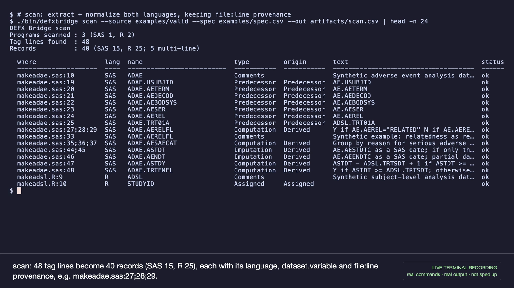
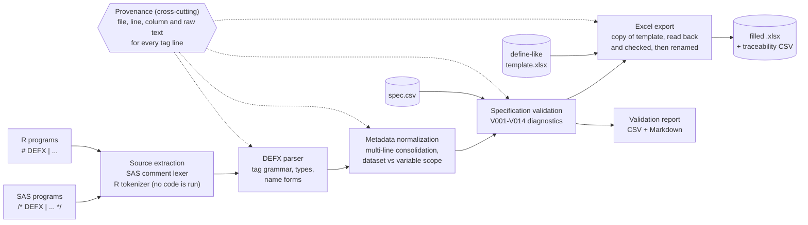

# DEFX Bridge

**Cross-language metadata extraction and validation for SAS and R statistical programs.**

[](https://github.com/parammadan/defx-bridge/actions/workflows/ci.yml)


DEFX Bridge reads structured **DEFX** documentation comments from **SAS and R** programs. It normalizes them into one table that records the source file and line of every tag line, validates them against an explicit specification, and fills a copy of a synthetic, define-like Excel workbook (Datasets, Variables, Methods and Comments sheets).

The idea comes from a published SAS workflow: Brendan Bartley and Megan Hinger, *Do One Task, Get Another Done for Free: Use DEFX Tags in Comments to Fill Out Your define.xml*, PharmaSUG 2026, Paper AP-220. In that workflow, the comment a programmer writes to document a derivation for code review also fills in the define.xml. DEFX Bridge is an **independently written R extension** of that idea. The same tag syntax works in R comments, so a study whose programs are a mix of SAS and R can keep one documentation convention.

> **Independent prototype.** DEFX Bridge is not affiliated with or endorsed by CBAR, the Harvard T.H. Chan School of Public Health, or PharmaSUG. It is not an implementation of the original DEFX macro, contains no code from the paper or any internal repository, and is not a clinically validated or regulatory-certified tool. All data in this repository is synthetic.

## Demo

**▶ [Watch the 2-minute demo on YouTube](https://youtu.be/h273icslijc)** (unlisted, AI-narrated, with captions). Backup: [download the MP4 from the v0.1.0 release](https://github.com/parammadan/defx-bridge/releases/download/v0.1.0/DEFX_Bridge_Demo_voiced.mp4). Every terminal scene is a real shell session recorded with [VHS](https://github.com/charmbracelet/vhs): real commands, real output, not sped up. See [demo/video_manifest.md](demo/video_manifest.md).

[](https://youtu.be/h273icslijc)

*Frame from the demo video: `scan` over one SAS and two R programs.*

Project page: <https://parammadan.github.io/defx-bridge/>

## Why it matters

- **Statistical programs carry two things:** the derivation logic, and the explanation of it that reviewers and define.xml need.
- **Keeping that explanation in a separate document is extra work.** Someone has to find the program and copy the logic into the define workbook at the end of a study, and the two can drift apart.
- **Structured source comments remove most of that work.** The comment next to the code *is* the metadata, so it is written while programming and checked during code review, as the original DEFX paper describes.
- **A shared representation helps mixed SAS/R work.** When one ADaM program is rewritten in R, its tags move with it unchanged, and the define workbook doesn't care which language a tag came from.
- **Validation and provenance make the metadata reviewable.** Every definition points back to `file:line`. Unknown variables, malformed tags and conflicting definitions are reported with their locations instead of being silently written.

## Architecture



Each box is a file under `R/`: `discovery.R`, `parser.R`, `normalize.R`, `validate.R`, `workbook.R`, `reports.R` and `cli.R`. Details are in [docs/ARCHITECTURE.md](docs/ARCHITECTURE.md).

## Features

All of the following are implemented and covered by the automated tests:

- **Two languages, one syntax.** SAS `/* DEFX | ... */` and R `# DEFX | ...` produce identical normalized records. A test checks this.
- **Supported tag patterns:**
  - Computation (the default type), Imputation, Predecessor and Assigned
  - variable and dataset Comments
  - a variable-only tag that applies in every dataset
  - parameter-level methods (`AVAL.<DS>.PARAMCD.EQ.<V>` and `<DS>.<VAR>.<V>`)
- **Multi-line consolidation.** Repeated lines for one name and type in one program become one method, in source order. They are never flagged as duplicates.
- **Provenance.** Every record keeps its first line, all contributing lines (e.g. `27;28;29`), the segment count and the exact raw comments.
- **Conservative lexing.** R is read with R's own tokenizer and never run. The SAS lexer skips strings and DATALINES. DEFX-like text inside a string literal is ignored.
- **Validation codes.** V001 malformed tag · V002 unknown target · V003 the same target in two programs (both locations reported) · V004 invalid type · V005 bad predecessor · V006 conflicting origins · V007 bad specification · V008 unreadable source · V009 target missing from template · V010–V014 warnings and info.
- **Safe workbook export:**
  - never overwrites the template, and writes to a temporary file first
  - in Datasets/Variables, writes **only the tag-owned cells of targeted rows**, cell by cell, so other cells (including formulas and numbers) are never rewritten
  - reads the result back with an independent reader (readxl) and runs 18 checks against the template **and** against the intended values: sheet names, untouched sheets cell by cell, columns and rows without tags, headers, that every targeted cell holds its tag value, and a `DO_NOT_CHANGE` sentinel
  - moves the file into place only if every check passes
  - writes **no** workbook if validation found errors, if no tags were found, or if `--out` is a directory; no output path may overwrite the spec, the template or a source program
- **CLI** `scan | validate | export | compare` with exit codes `0` (success), `2` (validation errors) and `1` (usage or runtime error). It doesn't print stack traces for input errors, works from any directory and with paths that contain spaces, can be piped to `head`, and fits its tables to the terminal width.
- **Repeatable.** Identical inputs give identical record CSVs (same checksum) and workbooks with identical content.

## Quick start

Requires R ≥ 4.1. Developed on R 4.6.1 on macOS; CI runs Ubuntu 24.04 with the current R release.

```bash
git clone https://github.com/parammadan/defx-bridge.git
cd defx-bridge
Rscript -e 'install.packages(c("openxlsx", "readxl", "testthat", "withr"))'

./bin/defxbridge --help
./bin/defxbridge scan     --source examples/valid --spec examples/spec.csv --out artifacts/scan.csv
./bin/defxbridge validate --source examples/valid --spec examples/spec.csv --out artifacts/validation.csv
./bin/defxbridge export   --source examples/valid --spec examples/spec.csv \
  --template examples/define_like_template.xlsx --out artifacts/define_like_filled.xlsx

./scripts/demo.sh        # guided walkthrough (DEMO_NO_PAUSE=1 to run straight through)
```

No SAS installation, server, database, API key or network connection is needed after the packages are installed. `bin/defxbridge` runs the code straight from the checkout, so the package doesn't have to be installed.

## Demonstration examples

These outputs come from the shipped synthetic examples.

**1. SAS documentation** (`examples/valid/makeadae.sas`)

```sas
/* DEFX | ADAE.AERELFL | Y if AE.AEREL="RELATED"     */
/* DEFX | ADAE.AERELFL | N if AE.AEREL="NOT RELATED" */
/* DEFX | ADAE.AERELFL | otherwise set to missing    */
/* DEFX | ADAE.AERELFL | Comments | Synthetic example: relatedness as recorded on the CRF */
```

**2. Equivalent R documentation** (`examples/valid/makeadsl.R`)

```r
# DEFX | ADSL.AGEGR1 | "<65" if AGE < 65;
# DEFX | ADSL.AGEGR1 | ">=65" if AGE >= 65;
# DEFX | ADSL.AGEGR1 | missing if AGE is missing
# DEFX | STUDYID | Assigned
```

**3. Normalized metadata** (`scan`)

```
Programs scanned : 3 (SAS 1, R 2)
Tag lines found  : 48
Records          : 40 (SAS 15, R 25; 5 multi-line)

  where                  lang  name           type         origin   text
  makeadae.sas:27;28;29  SAS   ADAE.AERELFL   Computation  Derived  Y if AE.AEREL="RELATED" N if AE.AERE…
  makeadsl.R:20;21;22    R     ADSL.AGEGR1    Computation  Derived  "<65" if AGE < 65; ">=65" if AGE >= …
```

*Rows excerpted; the status column is omitted.*

**4. Invalid variable detection** (`examples/invalid/unknown_variable.R`)

```
  [ERROR V002] unknown_variable.R:2  ADAE.DOESNOTEXIST is not in the specification
      fix: check the variable name; ADAE is a known dataset

Validation FAILED: 1 error(s), 0 warning(s), 0 info        # exit code 2
```

**5. Excel workbook generation** (`export`): all 18 checks pass. They end with `sentinel 'DO_NOT_CHANGE' count unchanged  PASS  template 5, output 5`, followed by:

```
Workbook         : artifacts/define_like_filled.xlsx
  Methods rows 18, Comments rows 5, Variables rows updated 34, Datasets rows updated 3
```

In the output, `ADAE.AERELFL` goes from the template's stale Origin `Assigned` to `Derived` with Method `ADAE.AERELFL`. Its Methods row now holds the three consolidated lines, and the hand-entered `Expression Code` cell is kept. Rows without tags and the `PreserveMe` sheet are unchanged.

### Workbook mapping

| Tag | Variables sheet | Methods | Comments | Datasets |
|---|---|---|---|---|
| Computation / Imputation | Origin `Derived`, Method = name | ID = Name = name, Type, Description | | |
| Predecessor | Origin `Predecessor`, Predecessor | | | |
| Assigned | Origin `Assigned` | | | |
| Variable Comments | Comment = name | | ID = name, Description | |
| Dataset Comments | | | ID = dataset, Description | Comment = dataset |
| Parameter-level method | (unchanged) | ID = Name = name | | |

As in the paper, method and comment IDs are the tag name. Rows in the template's Methods/Comments sheets that match no tag are dropped by default, which is analogous to the paper's `KEEPTAGS=N`. `--keep-unmatched` keeps them.

## Quality and testing

| Check | Result (last run) |
|---|---|
| Full suite, local (R 4.6.1, macOS) | **66 tests, 273 expectations: 0 failed, 0 skipped** |
| Full suite, CI (Ubuntu 24.04, R release) | **66 tests, 273 expectations: 0 failed, 0 skipped**, plus the demo script end to end |
| `R CMD check --no-manual` (CI and local) | **Status: OK**. 138 expectations pass; 23 tests skip by design (below) |

- The suite covers parsing, validation, workbook export and real `bin/defxbridge` runs, including exit codes, paths with spaces, running from another directory, and piping.
- **Independent audit (2026-11-12):** a separate review reproduced 12 defects that the earlier 52-test suite missed, including data-loss and false-success cases in export. All P0/P1 defects are fixed, and each has a regression test that fails on the pre-fix code. See [docs/DEFX_BRIDGE_INDEPENDENT_AUDIT.md](docs/DEFX_BRIDGE_INDEPENDENT_AUDIT.md), which also explains why passing tests alone overstated quality.
- **About the skips:** the built package excludes `examples/` and `bin/` (see `.Rbuildignore`), so under `R CMD check` the 23 tests that need the fixtures or the CLI skip. The separate CI job sets `DEFX_REQUIRE_FIXTURES=true` and fails if any test is skipped, so those tests always run there.
- Run the suite locally with `Rscript -e 'testthat::test_local(".")'`.

A passing test suite shows that the tool behaves as documented on the synthetic fixtures. **It is not evidence of CDISC compliance or Pinnacle 21 compatibility.** Details are in [docs/VALIDATION.md](docs/VALIDATION.md).

## Limitations

- **SAS parsing is partial and lexical.** It covers single-line `/* DEFX | ... */` comments, strings, statement comments and DATALINES. Macro quoting, `%include`, macro-generated code and tags inside multi-line block comments are not supported; the last of these is reported as V001.
- **No Pinnacle 21 compatibility guarantee.** The workbook is a synthetic, define-like template, not a Pinnacle 21-generated define.xlsx. In Datasets/Variables only tag-owned cells are written (a formula and a number elsewhere are shown to survive in tests). Methods/Comments are rebuilt from the tags, so formulas, cell types and styles in those two sheets are **not** preserved. Macros and styling in general are not promised.
- **No CDISC compliance certification.** DEFX Bridge does not generate define.xml or check CDISC or Pinnacle 21 conformance rules.
- **Not tested against CBAR production code.** Results have never been compared with the original DEFX macro or `defxit` on the same programs. The Variables-sheet update rules intentionally differ in a few places. See [docs/COMPATIBILITY.md](docs/COMPATIBILITY.md).
- **Clinical calculations are not validated.** The specification only establishes which targets exist. Whether a description matches the code, and whether a derivation is correct, still needs human review.

## Documentation

- [docs/ARCHITECTURE.md](docs/ARCHITECTURE.md): discovery, lexing, normalization, validation and export
- [docs/COMPATIBILITY.md](docs/COMPATIBILITY.md): what the paper describes, what is implemented, and what differs or is unverified
- [docs/VALIDATION.md](docs/VALIDATION.md): diagnostic codes, and what the tests do and don't establish
- [docs/DEMO.md](docs/DEMO.md): 90-second live script and interview Q&A
- [docs/DEFX_BRIDGE_INDEPENDENT_AUDIT.md](docs/DEFX_BRIDGE_INDEPENDENT_AUDIT.md): independent audit, confirmed defects and fixes, completion assessment
- [demo/](demo/): how the demo video is built and recorded; narration, storyboard, captions, manifest

## References and attribution

- Brendan Bartley and Megan Hinger, *Do One Task, Get Another Done for Free: Use DEFX Tags in Comments to Fill Out Your define.xml*, PharmaSUG 2026, Paper AP-220. <https://pharmasug.org/proceedings/2026/AP/PharmaSUG-2026-AP-220.pdf>
- Per the paper's acknowledgments, **Megan Hinger** created the original DEFX SAS macro, **Scott Anderson** created the `defxit` command-line script, and **Shawn Ward** heavily tested the original program.

DEFX Bridge was written from the published description. The tag syntax follows the paper so the same comments can be read by both tools. No appendix code was copied.

## License

MIT, see [LICENSE.md](LICENSE.md). [NOTICE.md](NOTICE.md) explains what the license does and doesn't cover: it covers this repository's code only, not the DEFX concept or third-party packages.
